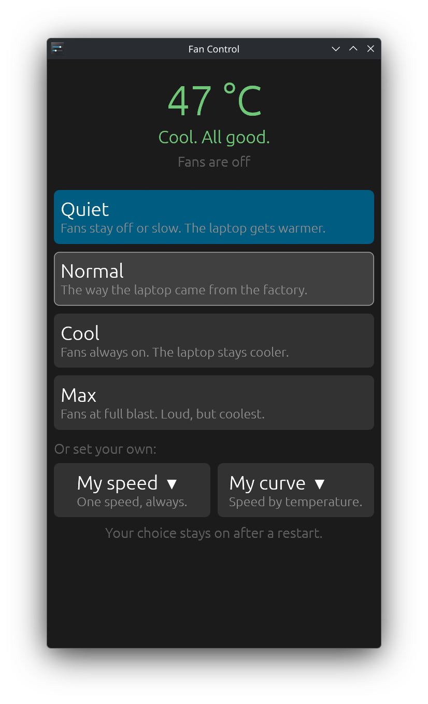
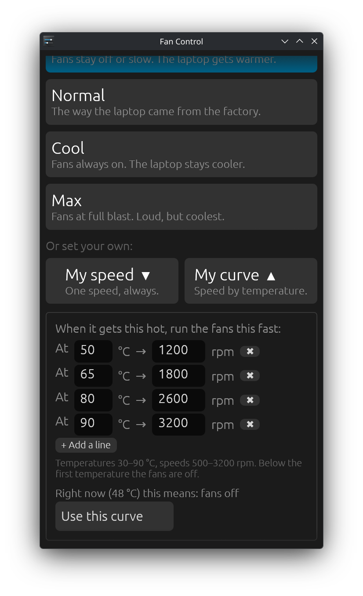
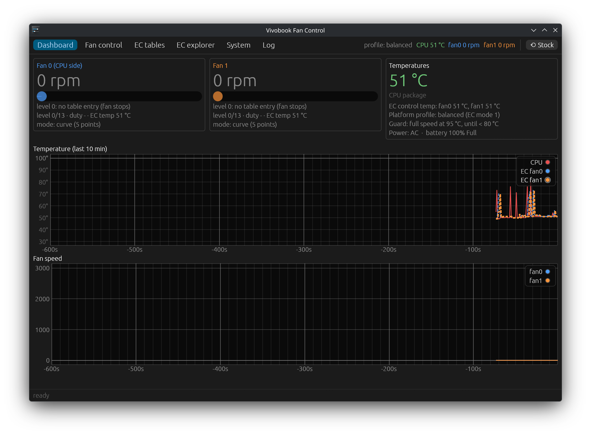
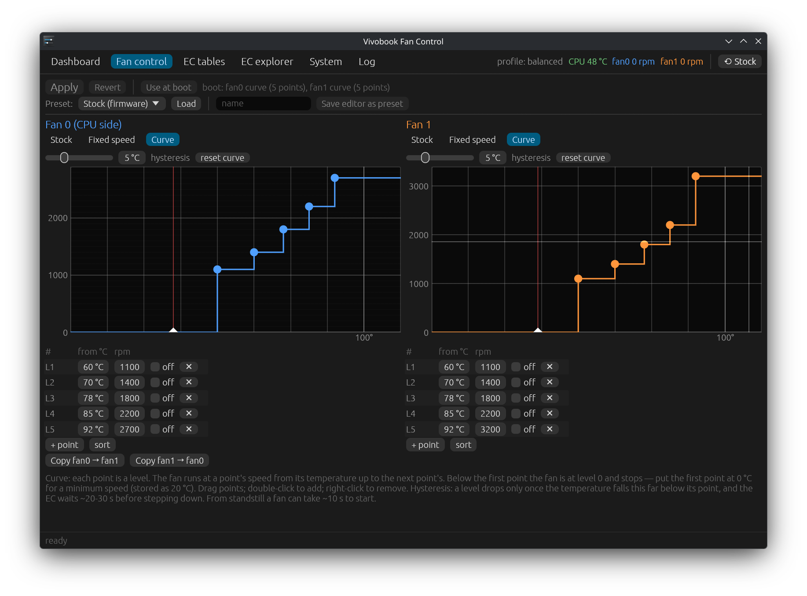
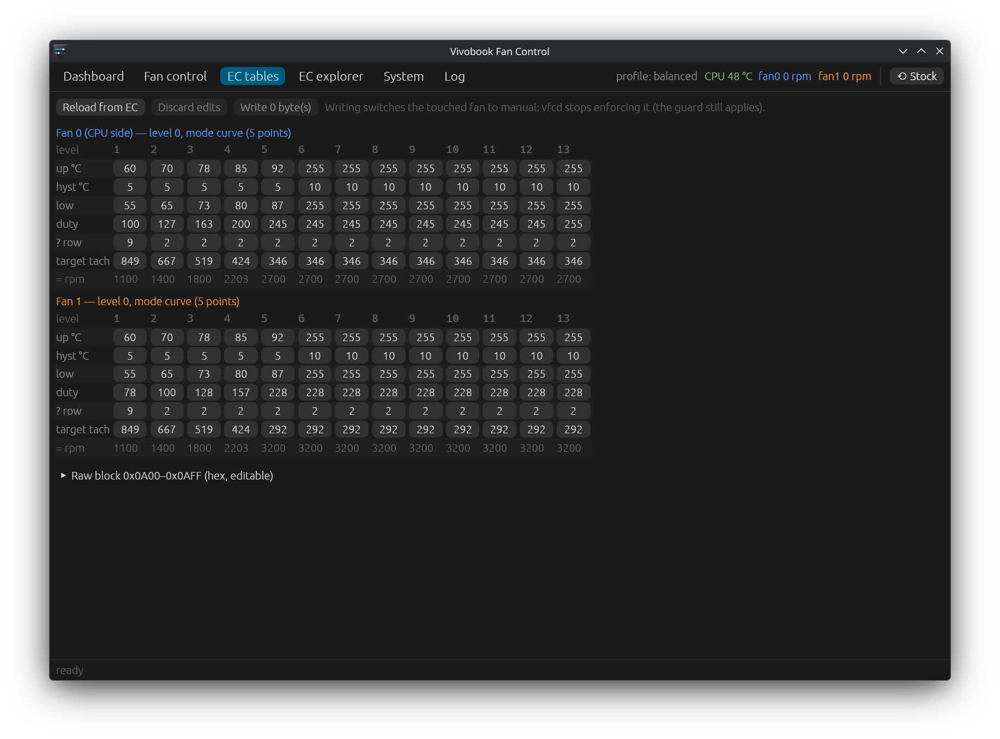

# vivobook-fancontrol

Fan control for the **ASUS Vivobook Pro 15 (N6506MU)** on Linux: quiet,
cool or full-blast modes, your own fixed speed, or your own fan curve, with
Secure Boot left on.

<p align="center">
  
  
</p>

The firmware only offers three thermal profiles. Under the hood, each profile
switch makes ACPI write fan tables into the embedded controller's RAM. This
project reverse-engineered those tables ([NOTES.md](NOTES.md)) and writes its
own, through the firmware's own EC mailbox methods.

> [!WARNING]
> This talks directly to the embedded controller. It only runs on the
> N6506MU (it checks the board name and refuses anything else), it keeps a
> temperature guard on, and it hands the fans back to the firmware when it
> stops, but it comes with **no warranty**. Not affiliated with ASUS.

## What you get

- **Fan Control** (`fan-control`) — the everyday app, in your app menu.
  The temperature in big numbers and four buttons: **Quiet**, **Normal**
  (factory), **Cool** and **Max**. One click applies it and it stays on after
  a restart.
  - **My speed**: type an rpm (500–3200). After applying, the app watches the
    real fans and confirms when they've reached it.
  - **My curve**: up to 8 lines of "at X °C run Y rpm". Input is checked
    (30–90 °C, rising temperatures, speeds never dropping as it gets hotter)
    before anything is sent.
- **vfc-gui** — the advanced app (run `vfc-gui`): live graphs, per-fan
  stock / fixed / curve modes with a draggable curve editor and hysteresis,
  presets, a decoded and raw EC table editor, an EC RAM explorer, platform
  profile, temperature guard, battery charge limit and the daemon log.
- **vfcd** — the root service that owns every EC write. It keeps your
  settings in place (the firmware rewrites the tables on every profile switch;
  vfcd re-applies them within ~3 s), runs the temperature guard, and restores
  the stock tables when it stops.
- **vfc** — command line: `vfc status`, `vfc set all 1800`, `vfc set 1 off`,
  `vfc set all stock`, plus the research commands used to map the EC
  (`read`, `tables`, `scan`, `diff`, `extract`, ...).

<details>
<summary>Advanced app screenshots</summary>





</details>

## Install

### 1. The `acpi_call` kernel module

vfcd calls the EC methods through [`acpi_call`](https://github.com/nix-community/acpi_call):

| Distribution  | Package |
|---------------|---------|
| Debian/Ubuntu | `sudo apt install acpi-call-dkms` |
| Arch          | `sudo pacman -S acpi_call-dkms` |
| Others        | build it from the link above |

**With Secure Boot on** the module must be signed by a key your firmware
trusts. On Ubuntu, DKMS signs it with its own Machine Owner Key and asks you
to enroll that key on the next boot (blue "MOK management" screen, then
"Enroll MOK" and the password you chose). Check with
`sudo modprobe acpi_call && ls /proc/acpi/call`.

### 2. vivobook-fancontrol

From a [release](https://github.com/schiz0x00/vivobook-fancontrol/releases):

```sh
tar xf vivobook-fancontrol-*-x86_64-linux.tar.gz
cd vivobook-fancontrol-*-x86_64-linux
sudo ./install.sh
```

Or from source (Rust 1.95 or newer):

```sh
git clone https://github.com/schiz0x00/vivobook-fancontrol
cd vivobook-fancontrol
cargo build --release
sudo ./install.sh
```

The installer copies the four programs to `/usr/local/bin`, loads
`acpi_call` at boot, and enables `vfcd.service`. Then open **Fan Control**
from the app menu.

The apps talk to vfcd over `/run/vfcd.sock`, which only the admin group
(`sudo`, or `wheel` on Fedora/Arch) can use. The installer tells you if
your user isn't in it.

### Uninstall

```sh
sudo ./uninstall.sh            # keeps /etc/vfc; add --purge to remove it
```

The fans go back to the firmware's tables when vfcd stops.

## Safety

- **Board check:** every EC access first checks that the DMI board name is
  `N6506MU`. The same addresses mean something else on other firmware.
- **Bounded writes:** vfcd only writes the fan table block the firmware
  itself writes (0x0A00–0x0AFF), and every byte is read back. (The research
  commands of `vfc` can also set the profile mode code and the firmware's
  table commit flags, nothing else.) Speeds are clamped to what
  the firmware's own "full" profile uses (fan0 2700, fan1 3200 rpm).
- **Guard:** custom modes go to full speed at 95 °C until everything is below
  80 °C (configurable in vfc-gui). The CPU's own thermal throttling and the
  EC's emergency shutdown are untouched.
- **Back to stock:** "Normal" in Fan Control, "⟲ Stock" in vfc-gui,
  `vfc set all stock`, or stopping vfcd restores the firmware tables (by
  switching the platform profile away and back).

## How it works

Each fan has 13 levels. The EC moves up a level for every temperature
threshold passed and runs the fan at that level's tach target, trimming the
duty cycle until it matches. A fixed speed is every threshold at 20 °C with
the same target on every level; a curve maps each point to a level. Details,
including the mistakes along the way, are in [NOTES.md](NOTES.md).

| Path | What |
|------|------|
| `src/tables.rs` | table layout and the encoding of fixed speeds and curves |
| `src/modes.rs` | Quiet / Normal / Cool / Max |
| `src/bin/vfcd.rs`, `src/proto.rs` | daemon and its socket protocol |
| `src/bin/fan-control/` | the simple app |
| `src/bin/vfc-gui/` | the advanced app |
| `src/main.rs` | the `vfc` CLI |
| `dumps/` | EC RAM dumps from the research |
| `extras/dgpu-power/` | optional: cut the NVIDIA dGPU's power on battery |

## Other models

Other Vivobooks probably use the same mechanism, at different addresses.
To explore one, set `VFC_FORCE_UNSUPPORTED=1` (the board check covers
reads too), start with the read-only `vfc tables` / `vfc scan` / `vfc read`,
and compare with [NOTES.md](NOTES.md) before writing anything. Do not
install vfcd on a board you have not mapped. Findings for other boards are welcome as issues.

## License

[GPL-3.0-or-later](LICENSE)
